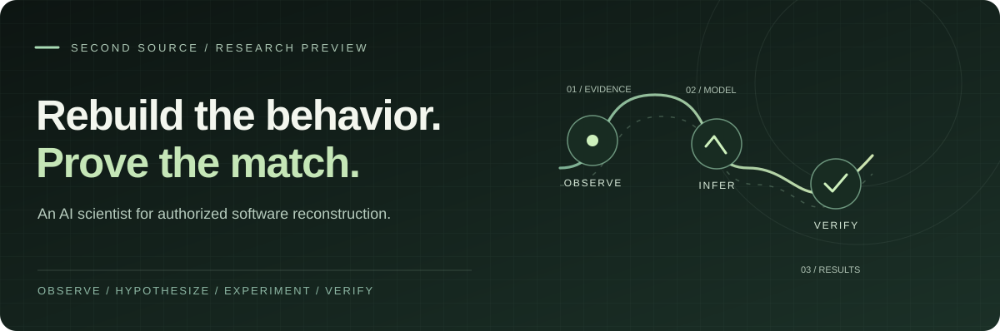

**From an observable black box to a separately implemented, evidence-tested substitute.**

[Why it exists](#why-not-just-ask-ai-to-copy-a-website) · [How it works](#how-second-source-works) · [Live capabilities](#what-works-today) · [Try it locally](#try-it-locally) · [Architecture](#system-architecture)

> [!IMPORTANT]
> **Engineering prototype, not a universal cloning service.** The repository has a reproducible **NON_AI** reconstruction/evaluation workflow and recorded **genuine Meta G2 reasoning**. A **successfully admitted and independently scored Meta-generated G3 reconstruction has not yet been demonstrated**. The public frontend is a static research preview; cloud authentication, storage, deployment, real-model repair, and arbitrary-target reconstruction are **not accepted as live production capabilities**. See [current evidence and release gates](#what-works-today).

## The idea

Most AI coding workflows begin with a description of what to build. **Second Source starts with an existing, authorized system whose behavior is not fully described.**

Instead of treating a screenshot or prompt as the specification, it asks: *What does this software actually do?* It observes permitted inputs and outputs, forms hypotheses about rules and state transitions, designs experiments to distinguish those hypotheses, proposes an independent implementation, and checks that candidate against a separate evaluator.

**The intended deliverable is not merely code.** It is a scoped implementation **plus the evidence, test results, limitations, and provenance needed to judge how closely it matches the reference**.

## Why not just ask AI to copy a website?

Imagine you own an older web application and prompt a coding assistant:

> “Build me a website that looks and works exactly like this one.”

The assistant may reproduce the layout, colors, pages, and obvious interactions. That can be the right solution for a visual prototype. But what should happen with unusual inputs, repeated actions, failed network requests, stored state, permissions, or an action taken in a different order? **The reference's screenshot does not answer those questions.** A capable coding agent can investigate and test those behaviors too—but it must be given that job, access, boundaries, and a way to verify its conclusions.

Second Source is an attempt to make **behavioral discovery and independent measurement** the core workflow, rather than optional follow-up prompting.

| Question | Typical “make me a site like this” workflow | Second Source's research workflow |
|:--|:--|:--|
| **What is the starting point?** | Screenshot, URL, and human instructions | Explicitly authorized, observable reference + declared scope |
| **Where do the requirements come from?** | Mostly the prompt, visible UI, and assumptions | Evidence-linked hypotheses and controlled reference experiments |
| **What about hidden state and edge cases?** | May be inferred, manually specified, or missed | Actively probed within allowed operations and budgets |
| **What gets generated?** | A plausible implementation of the requested experience | A scoped **independent** candidate tied to an inferred behavioral specification |
| **How is correctness assessed?** | Visual review and whatever tests are written | Reference-versus-candidate tests under a separate, withheld evaluation boundary |
| **What happens when it differs?** | More prompting and manual debugging | Recorded mismatches and bounded, auditable retries; feedback-conditioned repair remains future work |
| **What does the result prove?** | That the output looks or behaves convincing in inspected examples | Only the explicitly measured match on the tested cases, with unknowns left visible |

**The difference is not “AI builder versus better AI builder.” It is generation from an assumed specification versus reconstruction from experimentally observed behavior.** It does not guarantee perfect equivalence, and a standard AI coding agent with rigorous testing can achieve similar results on a well-specified task.

### A concrete example: two identical-looking applications

Suppose two implementations display the same ledger UI: **Add**, **Remove**, **List**, and **Total**.

They may be visually indistinguishable, yet differ when you:

- add an entry twice, then list entries;
- remove an entry that was never added;
- perform the same actions in a different order;
- enter a boundary value or malformed input;
- inspect whether totals and errors remain consistent after state changes.

These are **example questions, not claims about what a particular reference returns**. A screenshot cannot settle them. An authorized experiment can. The current repository's owned-ledger fixture provides a small, stateful CLI target for exercising this scientific method without touching somebody else's software.

~~~mermaid
flowchart LR
    subgraph PROMPT["Prompt-first reconstruction"]
      direction TB
      P["Screenshot / written prompt"] --> G["Generate UI and logic"]
      G --> V["Looks convincing?"]
    end
    subgraph SCIENCE["Evidence-first reconstruction"]
      direction TB
      R["Authorized reference"] --> O["Observe and question"]
      O --> H["Test hypotheses"]
      H --> C["Build independent candidate"]
      C --> E["Compare against withheld tests"]
      E --> A["Report matches, failures, unknowns"]
    end
    classDef input fill:#e6f1e7,stroke:#4a7a5a,color:#173324;
    classDef output fill:#d4edda,stroke:#34734d,color:#173324;
    classDef neutral fill:#eef1ef,stroke:#738f7d,color:#233b2c;
    class P,R input;
    class V,A output;
    class G,O,H,C,E neutral;
~~~

## How Second Source works

The central design is **CODE — Capture, Organize, Distill, Execute**. These are the product's durable lifecycle stages; within them, observation, hypothesis-driven experiments, candidate generation, and independent evaluation form the scientific loop.

| Stage | What the system does | What the user should be able to inspect |
|:--|:--|:--|
| **01 / Capture** | Define an authorized reference, allowed actions, exclusions, and a finite experiment budget. Record permitted observations. | Scope and evidence IDs |
| **02 / Organize** | Assemble observations, state transitions, provenance, and competing explanations. | Evidence-linked hypotheses and uncertainties |
| **03 / Distill** | Select informative experiments; freeze the approved context for generation. | Why a probe was chosen; approved request and digests |
| **04 / Execute** | Propose a candidate, admit its bounded specification, run it separately, and compare behavior. | Candidate identity, independent score, failures, and report |

~~~mermaid
flowchart TD
    S["Owner grants a narrow scope"] --> G{"Allowed operation?"}
    G -->|No| X["Reject and record boundary"]
    G -->|Yes| O["Reference observations"]
    O --> H["Evidence-linked hypotheses"]
    H --> Q["Model proposes distinguishing experiments"]
    Q --> V["Scope guard validates probes"]
    V --> O
    H --> F["Freeze approved generation context"]
    F --> M["Model-generated candidate specification"]
    M --> A{"Strict candidate admission"}
    A -->|Rejected| U["Record rejection; no score claimed"]
    A -->|Accepted| C["Bounded candidate execution"]
    C --> E["Independent withheld-suite evaluation"]
    E --> R["Evidence report: passed / failed / indeterminate"]
    R -. "Authorized bounded repair (future real mode)" .-> F
    classDef gate fill:#fff0da,stroke:#ad7a31,color:#51370d;
    classDef evidence fill:#e0f0e3,stroke:#4c825d,color:#193a26;
    classDef muted fill:#eef1ef,stroke:#819186,color:#26362b;
    class G,A,V gate;
    class O,H,E,R evidence;
    class S,X,Q,F,M,U,C muted;
~~~

### The trust boundary matters

**Second Source does not inspect or recover private reference source code.** An approved adapter exposes only permitted observable behavior. Model-facing inputs are redacted and scope-bound; the evaluator's sealed cases, reference internals, and gold answers are not sent to the candidate generator. Candidate execution is bounded, and results must retain **origin labels**: genuine model output, mock control, or trusted hand-authored control.

Its first candidate format is a **restricted, declarative specification**, not an unrestricted claim that it can clone arbitrary applications or safely execute arbitrary model-written programs. Pluggable adapters and isolated execution are part of the longer-term design.

## What works today

Engineering status checked 30 October 2026. Current GitHub state can change; the [delivery board](docs/G3_DELIVERY_BOARD.md) and linked PRs provide the detailed evidence trail. Some dated board entries are historical checkpoints, not the latest merged SHA.

| Area | Status | Evidence / limitation |
|:--|:--|:--|
| Owned-ledger observation, hypothesis and experiment flow | **Implemented for the approved fixture** | Genuine Meta-driven G2 reasoning recorded; **3 hypotheses, 5 observations, 2 real provider receipts** |
| Candidate admission and independent sealed evaluator | **Implemented and tested** | Reproducible controls: hand-authored positive **25/25**; deliberately defective controls trigger **2 / 2 / 1** failures |
| Scripted end-to-end reconstruction | **Demonstrated — NON_AI** | Mock candidate scores **22 passed / 3 failed / 0 indeterminate / 25** |
| Genuine Meta-generated G3 candidate | **Not yet demonstrated successfully** | Two real attempts consumed, neither produced an admitted, independently scored candidate |
| Bounded mock candidate repair | **Implemented on [PR #18](https://github.com/Ankit6149/second-source/pull/18); pending integration** | Frozen-context retries and versioned evidence; **not** real feedback-conditioned synthesis or real-model repair |
| Durable local API and worker | **Implemented** | Owner-scoped local SQLite lifecycle, cancellation/fencing, mock execution, sanitized export |
| Cloud backend and storage | **Source integrated, not live accepted** | Auth/PostgreSQL/Storage/Render/Railway preparation on [merged PR #19](https://github.com/Ankit6149/second-source/pull/19); live migrations, credentials, and hosted acceptance pending |
| Public website and evidence viewer | **Static preview implementation** | [Merged PR #20](https://github.com/Ankit6149/second-source/pull/20); browser-local viewer, not authenticated cloud investigation UI |
| E2B / Daytona sandbox | **Gated integration work** | Interface and fake tests exist; production sandbox execution is not enabled |

> [!NOTE]
> **25/25 is a trusted control, and 22/25 is a scripted mock result. Neither is a genuine model-reconstruction accuracy score.** Two genuine G3 attempts were consumed without an admitted candidate, and no additional paid inference is authorized by this project documentation.

## Try it locally

**Requirements:** Python 3.11+, Git, and a reviewed checkout. No Meta API key, billing card, or cloud account is needed for the nonbillable examples.

~~~bash
git clone https://github.com/Ankit6149/second-source.git
cd second-source

python -m venv .venv

# macOS / Linux
source .venv/bin/activate

# Windows PowerShell (instead)
# .\.venv\Scripts\Activate.ps1

python -m pip install -e ".[dev]"
python -m pytest -q

# Observe, generate and evaluate the owned fixture with a mock provider.
python -m second_source.reconstruct --mode mock

# Or exercise the local durable API → worker → evaluator workflow.
python -m second_source.backend --data-dir ../second-source-operator-data mock
~~~

The reconstruct command writes create-once run artifacts under `.runs/<run-id>/`, including a report and private candidate/broker evidence. The local backend command uses a data directory **outside the checkout** for its durable SQLite store. Keep that directory private and protected, as described in the [backend operations guide](docs/BACKEND_OPERATIONS.md). Results remain **NON_AI**.

**Windows bootstrap** (from a fresh checkout):

~~~powershell
powershell -NoProfile -ExecutionPolicy Bypass -File scripts/bootstrap-windows.ps1
.\.venv\Scripts\python.exe -m second_source.reconstruct --mode mock
~~~

For an offline-friendly public-site preview:

~~~bash
python web/preview.py
# Open http://127.0.0.1:8766/
# The static research console is at /console/
~~~

This web preview **does not** authenticate users, launch model inference, or execute backend jobs. See [web/README.md](web/README.md) for the allowlisted Vercel build instructions.

## System architecture

Second Source separates the **scientific engine**, **trusted control plane**, **model boundary**, and **independent verifier**. The modularity is intentional: learning a new target class should require a reviewed adapter and test contract, not a new hard-coded reconstruction engine.

~~~mermaid
flowchart TB
    U["Product UI / operator CLI"]
    API["Authenticated control plane scope, jobs, approvals, lifecycle"]
    DB[("Durable state SQLite local / PostgreSQL prepared")]
    W["Bounded worker / engine adapter"]
    REF["Authorized reference adapter"]
    G2["Observations + hypotheses"]
    META["Approved model gateway"]
    SPEC["Admitted CandidateSpec"]
    VER["Independent evaluator withheld tests"]
    ART["Private artifacts + sanitized report"]

    U --> API
    API --> DB
    API --> W
    W --> REF
    REF --> G2
    G2 --> META
    META --> SPEC
    SPEC --> VER
    REF --> VER
    VER --> ART
    ART --> API

    classDef trusted fill:#dfeee4,stroke:#4e805d,color:#183628;
    classDef boundary fill:#fff0da,stroke:#ab7835,color:#5a3c14;
    classDef neutral fill:#eef1ef,stroke:#819186,color:#26362b;
    class API,DB,W,ART trusted;
    class REF,META,VER boundary;
    class U,G2,SPEC neutral;
~~~

**Deployed vs proposed:** the CLI and local mock backend are implemented. Vercel hosts only the public frontend when independently deployed; the Render/Supabase cloud backend is prepared in source but has not passed live deployment acceptance. E2B is a proposed isolated execution provider, with Daytona as an alternative, **not an active fallback currently running**. Genuine Meta model dispatch is controlled separately by exact-input approval and spending limits.

## Where this could go

The long-term objective is a **scope-aware reconstruction platform** for owners of software whose behavior is partially documented: internal APIs, legacy CLI tools, controlled web workflows, and eventually larger multi-component systems.

For a complex target, the intended approach is to discover observable subsystems, decompose behavior into independently testable contracts, map dependencies, reconstruct each component, and test integration boundaries. **This is a roadmap, not a claim that arbitrary websites, authenticated third-party systems, desktop applications, or production services are supported today.**

The research questions are measurable: does active experimentation reveal behavior missed by passive examples? Does bounded feedback improve withheld-test conformance? Can evidence explain failures without leaking the hidden evaluator? A convincing result requires real model-origin receipts and independent, reproducible scoring—not a polished screenshot.

## Repository guide

| Start here | What it contains |
|:--|:--|
| [Master PRD](docs/MASTER_PRD.md) | Product goals, scientific method, architecture, constraints, roadmap |
| [Delivery board](docs/G3_DELIVERY_BOARD.md) | Historical evidence checkpoints and release gates |
| [Reconstruction operator guide](docs/G3_RECONSTRUCT.md) | Mock, preflight and gated real-mode CLI contracts |
| [Backend operations](docs/BACKEND_OPERATIONS.md) | Local API, worker, SQLite durability, cancellation, export |
| [Cloud backend operations](docs/CLOUD_BACKEND_OPERATIONS.md) | Prepared Render/Supabase deployment and missing acceptance gates |
| [Frontend ↔ backend contract](docs/FRONTEND_BACKEND_CONTRACT.md) | Typed API workflow and supported/unavailable capabilities |
| [Independent evaluator acceptance](docs/G3_VERIFIER_ACCEPTANCE.md) | Controls, boundaries and sealed-suite test protocol |
| [Hackathon demo/runbook](docs/HACKATHON_SUBMISSION_RUNBOOK.md) | Reproducible demonstration and submission evidence |
| [Web preview](web/README.md) | Static site preview, assets and Vercel configuration |

## Responsible use and limitations

Second Source is designed **only for software you own or are explicitly authorized to investigate**. It is not a source-code extractor, access-control bypass, DRM circumvention tool, or guarantee of complete behavior equivalence. Every experiment must stay inside explicit permissions, scope, rate and spending budgets.

A reported score is meaningful **only for its identified reference, candidate, test suite, evaluator version, and run provenance**. Unexpected errors, unavailable operations, indeterminate results, and incomplete evidence must remain visible. The system should say *cannot verify* rather than imply a match it cannot support.

---

**Build from evidence. Measure the difference. Preserve the uncertainty.**

Second Source · Meta Global AI Developer Hackathon · indie research project

