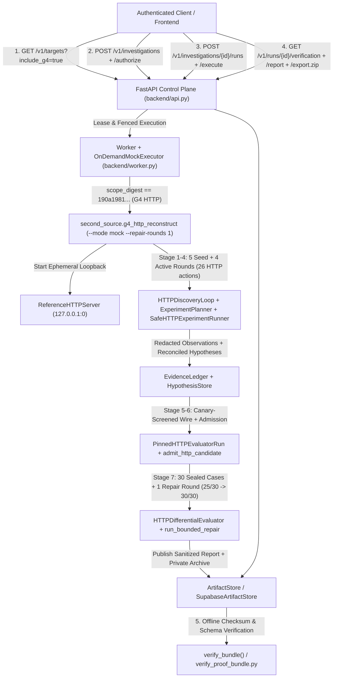

# G4 Owned HTTP Task-Workflow Reference Target, End-to-End Pipeline & Integration Contract

**Target ID:** `owned-http-task-workflow-v1`  
**Subsystem ID:** `http_task_workflow` (`REQ-HTTP-TASKS`)  
**Owner:** Argon (G4 Independent Engineering Stream)  
**Branch:** `feat/g4-owned-http-reference-argon` (PR #27)  
**Base Commit:** `951ed681ab707a54e9e76a3377546235c98a0369` (`origin/main`)

---

## 1. Repository Reconnaissance & Documentation Audit

Before implementing this fixture and pipeline integration, the repository documentation, issues, pull requests, and source code across `origin/main` (`951ed681`), Muse PR #23 (`d7508ce`), and Codex PR #24 (`ee81f37`) were audited.

### Verified Document vs. Implementation Discrepancies

1. **G3 Live Attempt Count & Admitted Candidate Status:**
   - `README.md`, `docs/G3_DELIVERY_BOARD.md`, and `docs/G3_ACCEPTANCE.md` on `origin/main` state that only 2 real paid G3 attempts have been made with `0` admitted candidates.
   - On PR #23 (`d7508ce`), `docs/G3_AUTHORIZATION_PACKET.md` and `docs/G3_RECONSTRUCT.md` record **Attempt 5 (rev-6)** admitted on `2026-10-31` and independently scored on the 25-case sealed CLI suite at **14/25 match (`0.56`), 11 mismatched (9 `schema`, 2 `error`), 0 indeterminate**.
2. **Branch HEAD Pointers in Governance Docs:**
   - `docs/G3_DELIVERY_BOARD.md` lists `main` as `1ba8905` and `docs/G3_ACCEPTANCE.md` lists `main` as `2dd919b`, whereas `origin/main` is at `951ed681` (PR #21 merged).
3. **Repair Loop Implementation Status:**
   - `docs/G3_REPAIR_CONTRACT.md` on `origin/main` states that `G3MockEngine` does not integrate `--repair-rounds` and feedback-conditioned synthesis is unimplemented. In code, `origin/main` (`2eca165`) already wires bounded mock repair into the durable worker, and PR #23 (`07553b8`) implements feedback-conditioned repair (`synthesize-v2-repair1`), though no live paid repair attempt has been executed yet.
4. **Referenced Documents Not Present in Repo:**
   - `docs/MASTER_PRD.md` (§2.4, §5.6) references `docs/ARCHITECTURE.md`, `docs/RESEARCH_PROTOCOL.md`, `docs/SECURITY.md`, and `research/experiments/`, which do not exist as separate files; their substance is consolidated in `docs/MASTER_PRD.md`, `docs/G3_VERIFIER_ACCEPTANCE.md`, and `docs/G3_RECONSTRUCT.md`.
5. **Protocol Generalization Gap in Core Engine:**
   - `ScopeContract` (`src/second_source/contracts.py`), `ScopeGuard` (`src/second_source/scope_guard.py`), and `ExperimentPlanner` (`src/second_source/planner.py`) already support `TargetKind.HTTP` (allowed URL patterns, permitted HTTP action kinds, roles, and exclusions).
   - `fixtures/owned_ledger_variant/` (on PR #23) changes three internal ledger rules (`round_half_up`, per-tag running balance, `remove` return value) while keeping the exact same JSONL `add`/`list`/`total`/`remove` CLI protocol. It therefore tests rule variation within the CLI ledger family rather than protocol generalization to a stateful HTTP API.

---

## 2. End-to-End Evidence-Driven Architecture for `TargetKind.HTTP`

This workstream connects the full Second Source scientific pipeline across `owned-http-task-workflow-v1` (`TargetKind.HTTP`) without modifying any of the 22 code-pinned G3 files or weakening safety boundaries:

```
Scope (create_http_scope + ScopeGuard)
  -> Observe (SafeHTTPExperimentRunner + HTTPReferenceAdapter + EvidenceLedger)
  -> Hypothesize (ExperimentPlanner.hypothesize + HypothesisStore + validate_batch)
  -> Experiment (ExperimentPlanner.propose + score_utility + SafeHTTPExperimentRunner.run + reconcile_predictions)
  -> Candidate Generation Contract (PinnedHTTPEvaluatorRun.prepare + prepare_http_generation_request + ModelGateway)
  -> Admission (load_http_candidate + ScopeGuard.validate_candidate_files + HMAC-signed BrokerArtifact)
  -> Independent Verification (PinnedHTTPEvaluatorRun.evaluate + HTTPDifferentialEvaluator + DifferentialVerifier)
  -> Bounded Repair (second_source.repair_loop.run_bounded_repair + select_best + SELECTION_POLICY)
  -> Provenance-Correct Report (G4_report.json + sanitized_report + ArtifactStore.publish_report + verify_bundle)
```

### Boundary-by-Boundary Proof Table

| Pipeline Stage | Core Module Reused | HTTP Target Component | Executable Proof |
|---|---|---|---|
| **1. Scope** | `ScopeContract`, `ScopeGuard` | `create_http_scope()` | `test_scope_guard_and_safe_http_experiment_runner_enforce_boundaries`, `test_adversarial_scope_bypass_urls_verbs_roles_and_planner_smuggling` |
| **2. Observe** | `EvidenceLedger`, `Observation`, `SequenceResult` | `HTTPReferenceAdapter`, `SafeHTTPExperimentRunner` | `test_reference_server_crud_transitions_and_deterministic_reset` |
| **3. Hypothesize** | `ExperimentPlanner.hypothesize`, `HypothesisStore`, `validate_batch` | `HTTPDiscoveryLoop(DiscoveryLoop)` | `test_end_to_end_cli_mock_and_repair_and_artifact_bundle` |
| **4. Experiment** | `ExperimentPlanner.propose`, `score_utility`, `reconcile_predictions` | `SafeHTTPExperimentRunner.run(actions)`, `from_proposed_action` | `test_end_to_end_cli_mock_and_repair_and_artifact_bundle`, `test_adversarial_scope_bypass_urls_verbs_roles_and_planner_smuggling` |
| **5. Generation Contract** | `ModelGateway`, `ModelRequest`, `RunBudget`, `BrokerArtifact` | `PinnedHTTPEvaluatorRun.prepare()`, `prepare_http_generation_request()` | `test_generation_wire_isolation_blocks_reference_and_sealed_case_leakage`, `test_adversarial_leaked_sealed_material_blocked_at_all_boundaries` |
| **6. Candidate Admission** | `ScopeGuard.validate_candidate_files` | `PinnedHTTPEvaluatorRun.generate()`, `load_http_candidate()`, `HTTPCandidateSpec` | `test_candidate_admission_rejects_out_of_scope_and_malformed_specs`, `test_adversarial_candidate_rejection_and_broker_accounting` |
| **7. Independent Verification** | `DifferentialVerifier`, `EvaluationReport`, `SealedCase` | `PinnedHTTPEvaluatorRun.evaluate()`, `HTTPDifferentialEvaluator`, `HTTPCandidateInterpreter` | `test_differential_evaluator_scores_30_held_out_cases_and_core_verifier_compat`, `test_adversarial_replay_consistency_and_ticket_signature_integrity` |
| **8. Bounded Repair & Report** | `run_bounded_repair`, `select_best`, `ArtifactStore`, `sanitized_report`, `verify_bundle` | `second_source.g4_http_reconstruct` (`G4_report.json`) | `test_end_to_end_cli_mock_and_repair_and_artifact_bundle` |

---

## 3. Public Observation Contract & Hidden Reference Rules

### Public Observation Contract (`fixtures/owned_http_task_workflow/public_contract.json`)
The public observation contract is the **only** target metadata provided to the reconstruction planner or model generation prompt:
- **Target Kind:** `TargetKind.HTTP`
- **Scheme / Host:** `http://127.0.0.1:<ephemeral_port>`
- **Allowed URL Patterns:** `("/v1/tasks", "/v1/tasks/*")`
- **Permitted Action Kinds:** `{"http_get", "http_post", "http_patch", "http_delete"}`
- **Excluded Control Plane:** `("/__admin/**",)` is used exclusively by `HTTPReferenceAdapter` between sequences (`POST /__admin/reset`) and is blocked by both `ScopeGuard` (`EXCLUDED_ROUTE`) and `HTTPReferenceAdapter` (`control_plane_access_denied`).
- **Synthetic Identities (`X-Synthetic-Actor`):** `alice` (`member`), `bob` (`member`), `viewer` (`viewer`), `admin` (`admin`), plus unauthenticated (`401 unauthenticated` with `WWW-Authenticate: SyntheticActor realm="owned-task-workflow"`).

### Hidden Reference Rules (`fixtures/owned_http_task_workflow/reference_server.py`)
1. **Authentication & Authorization Precedence:**
   - Route & HTTP method checks run first (`404 unknown_endpoint` for unknown routes; `405 method_not_allowed` with deterministic `Allow` header for unsupported verbs).
   - Every `/v1/tasks` request next validates `X-Synthetic-Actor`. Missing or unrecognized actors return `401` (`error = "unauthenticated"`).
   - Role checks (`viewer` attempting `POST`, `PATCH`, or `DELETE`) return `403` (`error = "insufficient_role"`) **before** body validation or resource lookup.
   - Ownership checks on `PATCH /v1/tasks/{task_id}` and `DELETE /v1/tasks/{task_id}` run after confirming the task exists (`404 not_found` if absent) and before applying field validation or state transitions (`403 not_owner` if `actor != task.owner` and `role != "admin"`).
2. **Task Creation (`POST /v1/tasks`):**
   - Body must be a finite JSON object (`<= 32,768` bytes) with no duplicate keys (`400 invalid_json`).
   - Validation precedence:
     1. `title`: required string; trimmed of leading/trailing whitespace; post-trim length must be `1..64` (`422 invalid_title`).
     2. `priority`: required strict integer (`bool` rejected) in `1..5` (`422 invalid_priority`).
     3. **Per-Owner Case-Insensitive Active Duplicate Title Rule:** An owner cannot have two non-cancelled tasks with the same `title.strip().casefold()`. Conflicts return `409 duplicate_title`. Once a task transitions to `cancelled`, its title reservation is released for that owner.
   - Assigns monotonic ID `tsk-1`, `tsk-2`, ..., `status="todo"`, `owner=actor`, `revision=1`, and returns `201 Created` with `location: /v1/tasks/{id}` and `x-task-revision: 1`.
3. **Workflow State Transitions (`PATCH /v1/tasks/{task_id}`):**
   - Requires at least one of `title`, `priority`, `status` (`422 empty_update`).
   - **Terminal State Lock:** Tasks in `done` or `cancelled` reject any `PATCH` (even metadata edits or self-transitions) with `409 terminal_state_locked`.
   - **Allowed Non-Terminal Transitions:**
     - `todo -> in_progress | blocked | cancelled` (`todo -> done` is **forbidden** with `409 invalid_transition`; a task must pass through `in_progress` before `done`).
     - `in_progress -> todo | blocked | done | cancelled`
     - `blocked -> todo | in_progress | cancelled` (`blocked -> done` is **forbidden** with `409 invalid_transition`).
   - Every accepted `PATCH` increments `revision` by `+1` and updates `x-task-revision`.
4. **Deletion Rule (`DELETE /v1/tasks/{task_id}`):**
   - Tasks in `in_progress` cannot be deleted directly (`409 task_in_progress`); they must first transition out of `in_progress`.
5. **Collection Filtering, Ordering & Pagination (`GET /v1/tasks`):**
   - Filters: `status`, `owner`, `min_priority` (`1..5`), `max_priority` (`1..5`), with `min_priority <= max_priority` (`422 invalid_filter`).
   - Ordering (`order_by`): `id_asc` (default), `id_desc`, `priority_desc` (`(-priority, seq)`), `priority_asc` (`(priority, seq)`), or `422 invalid_order`.
   - Pagination: `limit` (`1..50`, default `10`), `offset` (`>= 0`, default `0`), or `422 invalid_pagination`.

---

## 4. Matched-Budget & Observation-Derived Benchmark (`run_competitive_benchmark`)

### 4.1 Upgraded v2 Benchmark Design (`2.0-matched-budget-observation-derived`)

To eliminate action-budget asymmetry and predetermined per-arm fills:
1. **Strict Action & Experiment Budget Parity (Arm B vs. Arm C):** Both `B_passive_fixed_probes` (`passive_matched_probe_sequences()`) and `C_active_evidence_driven` (`active_discriminating_sequences()`) execute **5 experiments** and **15 HTTP actions** (`3 actions per sequence`), with an identical `4096` output-token ceiling and the identical 30-case held-out stateful suite.
2. **Uniform Blinded Observation-to-Spec Rule Extractor:** Every arm starts from the exact same uninformed prior (`build_uninformed_prior_fill()`) and updates spec parameters strictly through `derive_fill_from_observations(observations)`. A rule parameter is updated **only** when an observed `(input_action, output)` pair provides direct empirical evidence for that rule.
3. **Explicit Evidence Attribution (`evidence_attribution`):** Every arm records:
   - `rules_revealed_by_probes`: map of `{rule_key: [observation_id_or_digest, ...]}` proving which specific HTTP probe revealed each hidden rule.
   - `prior_assumptions_retained`: list of discoverable hidden rules that were never triggered by that arm's probes and therefore remained at the uninformed prior.
   - `skeleton_and_public_contract_priors`: baseline assumptions derived from `public_contract.json`.

| Arm | Strategy | Budget (`Exps / Actions`) | Rules Revealed by Probes (`of 8`) | Unobserved Rules Left at Prior | Held-Out Score (`NON_AI` Mock) |
|---|---|---:|---:|---|---:|
| **`A_direct_synthesis`** | Uninformed prior + 1 seed sequence | `1 exp / 3 actions` | `0 / 8` | All 8 hidden rules | **19 / 30 (`63.3%`)** |
| **`B_passive_fixed_probes`** | Matched-budget happy-path & basic bound probes | `5 exps / 15 actions` | `4 / 8` (`title_max_length_64`, `priority_maximum_5`, `duplicate_title_casefold_per_owner`, `pagination_max_limit_50`) | `cancelled_frees_title`, `forbid_shortcut_transitions_to_done`, `terminal_statuses_locked`, `delete_in_progress_blocked` | **25 / 30 (`83.3%`)** |
| **`C_active_evidence_driven`** | Matched-budget boundary-discriminating probes | `5 exps / 15 actions` | `8 / 8` (all hidden rules empirically witnessed) | `[]` (`0` left at prior) | **30 / 30 (`100.0%`)** |
| **`D_bounded_repair`** | Aggregate-feedback repair from Arm B + 4 targeted probes | `5 + 4 exps / 27 actions` | `8 / 8` | `[]` (`0` left at prior) | **25 / 30 -> 30 / 30 (`+16.7%`)** |

> **Scientific Limitation Disclosure:** All arms in `run_competitive_benchmark()` use the deterministic rule extractor `derive_fill_from_observations` (`origin="mock", real=False`, `claim="NON_AI_DETERMINISTIC_SCAFFOLDING_NOT_MODEL_QUALITY"`). This proves that under an **identical 5-experiment / 15-action budget**, active boundary-falsifying probes empirically reveal the 4 hidden workflow/deletion/cancellation rules that passive probes miss. It does **not** prove genuine Meta LLM reasoning superiority, which remains **BLOCKED** pending owner-authorized paid inference.

### 4.2 Retained Historical v1 Scaffolding (`historical_v1_scaffolding`)

Retained in `HISTORICAL_V1_SCAFFOLDING_SUMMARY` and `run_competitive_benchmark()["historical_v1_scaffolding"]` for audit continuity:
- `A_direct_synthesis` (`1 exp / 2 actions`, predetermined `build_http_naive_direct_fill`): `19 / 30`
- `B_passive_fixed_probes` (`5 exps / 12 actions`, predetermined `build_http_passive_probe_fill`): `26 / 30`
- `C_active_evidence_driven` (`5 exps / 15 actions`, predetermined `build_http_guided_fill_control`): `30 / 30`
- `D_bounded_repair` (`5 exps + 1 repair round`): `26 / 30 -> 30 / 30`

---

## 5. Reproducible Local G4 CLI Demonstration (`NON_AI`)

Any engineer can reproduce the complete G4 HTTP pipeline on a fresh checkout with zero API keys and zero external services:

```powershell
# 1. Baseline nonbillable G4 HTTP pipeline run (25/30 on 30-case sealed suite)
$env:PYTHONPATH="src;."
.venv\Scripts\python.exe -m second_source.g4_http_reconstruct --mode mock

# 2. Full G4 HTTP pipeline with 1 bounded repair round (25/30 -> 30/30, verdict="improved")
$env:PYTHONPATH="src;."
.venv\Scripts\python.exe -m second_source.g4_http_reconstruct --mode mock --repair-rounds 1

# 3. Run all G4 HTTP reference, evaluator, benchmark, pipeline, and adversarial tests
$env:PYTHONPATH="src;."
.venv\Scripts\python.exe -m pytest `
  tests/test_g4_http_task_workflow_reference.py `
  tests/test_g4_http_task_workflow_evaluation.py `
  tests/test_g4_http_task_workflow_benchmark.py `
  tests/test_g4_http_pipeline_and_adversarial.py -v
```

### Sample Reproducible CLI Output (`--mode mock --repair-rounds 1`)

Stderr stage progression:
```json
{"progress": "evidence_ready", "run_id": "g4-http-...", "detail": "26 HTTP observations recorded across seed + 4 active rounds"}
{"progress": "inspected", "run_id": "g4-http-...", "detail": "broker request inspected, zero calls"}
{"progress": "admitted", "run_id": "g4-http-...", "detail": "candidate sha256:d6ff08c9ca410f3a2de48a600c1c936a11cd0cdcc383a0ad2f44a94187a62a70"}
{"progress": "repair", "run_id": "g4-http-...", "detail": "bounded retry of up to 1 round(s) after initial 5 failed / 0 indeterminate"}
{"progress": "repaired", "run_id": "g4-http-...", "detail": "verdict improved"}
{"progress": "evaluated", "run_id": "g4-http-...", "detail": "30/30 sealed HTTP cases"}
{"progress": "reported", "run_id": "g4-http-...", "detail": "G4_report.json"}
```

Stdout summary receipt:
```json
{
  "result": "completed_mock_run",
  "run_id": "g4-http-...",
  "target_id": "owned-http-task-workflow-v1",
  "target_kind": "http",
  "mode": "mock",
  "origin": "mock",
  "real": false,
  "claim_classification": "NON_AI_DETERMINISTIC_DEMONSTRATION_NOT_META_MODEL",
  "passed": 30,
  "failed": 0,
  "indeterminate": 0,
  "total": 30,
  "estimated_cost_usd": 0.0,
  "uncertain_cost_usd": 0.0,
  "spec_digest": "sha256:01426c9117166deb318eae090b06b2c9b9f98795da03e26ff1b886e4e8afc60c",
  "suite_digest": "sha256:...",
  "g4_gate_verdict": {
    "local_non_ai_pipeline_gate": "PASSED",
    "scientific_isolation_gate": "PASSED",
    "matched_budget_benchmark_gate": "PASSED",
    "genuine_meta_model_g4_gate": "BLOCKED_AWAITING_PAID_INFERENCE_APPROVAL",
    "overall_g4_verdict": "LOCAL_ENGINEERING_PASSED_REAL_INFERENCE_BLOCKED"
  }
}
```

### Run Directory Artifacts Written (`.runs/g4-http-<id>/`)
- `evidence/<sha256>.json`: Content-addressed HTTP observations in `EvidenceLedger`.
- `G4_discovery_summary.json`: Seed + 4 active `ExperimentPlanner` rounds, `reconcile_predictions` verdicts, and `derive_fill_from_observations` attribution.
- `generation-dispatch.v1.private.json` & `generation-result.v1.private.json` (plus `.r1.private.json` on repair): Private `ModelGateway` audit records.
- `candidate.v1.json` & `broker-artifact.v1.json` (plus `candidate.r1.json` & `broker-artifact.r1.json`): Admitted `HTTPCandidateSpec` bytes and HMAC-signed `BrokerArtifact` envelopes.
- `evaluation-receipt.v1.json` & `evaluation-manifest.v1.json` (plus `.r1.json`): Per-version evaluation receipts and full pinned manifests.
- `G4_repair_history.json` (and `G3_repair_history.json` alias): Bounded repair lineage (`25/30 -> 30/30`, `verdict="improved"`, `stop_reason="repaired_to_perfect"`).
- `G4_report.json` (and `G3_report.json` alias): Complete run report passing `second_source.backend.artifacts.sanitized_report()` and `ArtifactStore.publish_report()`.

---

## 6. Backend, Worker & Frontend Integration Architecture (Codex Handoff)

`owned-http-task-workflow-v1` is **fully integrated into `src/second_source/backend/api.py` and `src/second_source/backend/worker.py`** while preserving 100% backward compatibility with all existing G3 (`owned-ledger-v1`) tests and PR #24 / PR #23.

### 6.1 End-to-End Architecture & Data-Flow Diagram



### 6.2 Target Registration Contract & Discovery (`/v1/targets`)
- **Target Identifier (`target_id` / `permission_ref`):** `"owned-http-task-workflow-v1"`
- **Target Label (`label`):** `"Owned HTTP task-workflow fixture"`
- **Target Kind (`TargetKind`):** `TargetKind.HTTP` (`"http"`)
- **Run Kind (`run_kind`):** `"g3_mock"` (`origin="mock", real=False`)
- **Canonical Scope Factory & Digest:**
  ```python
  from second_source.g4_http_reconstruct import create_g4_http_scope
  from second_source.g2_persistence import scope_digest_of

  scope = create_g4_http_scope(0)
  # scope_digest_of(scope) == "sha256:190a19810a956c5626594bd6d48f7b6d37d3355e28ffaa50f177d6df6c85f8fe"
  ```
- **Discovery Endpoints (`GET /v1/targets`):**
  - `GET /v1/targets` (default, no query params): returns `[owned-ledger-v1]` so all existing single-target unpack assertions (`target, = ...`) remain 100% green.
  - `GET /v1/targets?include_g4=true`: returns `[owned-ledger-v1, owned-http-task-workflow-v1]`.
  - `GET /v1/targets?target_id=owned-http-task-workflow-v1`: returns `[owned-http-task-workflow-v1]`.
  - `GET /v1/targets?target_id=<unknown>`: returns `422 UNSUPPORTED_TARGET`.

### 6.3 Worker Lifecycle, Runtime Isolation & Reset Semantics
1. **Scope-Digest-Gated Worker Dispatch (`G3MockEngine.execute` in `src/second_source/backend/worker.py`):**
   - `G3MockEngine` inspects `scope_digest_of(lease.scope)`:
     - `dbf5a0d74502ed6662f551e57ad25ecb902c8c15439186fa5173a54ad9c25c53` (`owned-ledger-v1`) -> dispatches `second_source.reconstruct`.
     - `190a19810a956c5626594bd6d48f7b6d37d3355e28ffaa50f177d6df6c85f8fe` (`owned-http-task-workflow-v1`) -> dispatches `second_source.g4_http_reconstruct`.
     - Any other scope or `run.kind != "g3_mock"` fails closed immediately with `BackendError("UNSUPPORTED_SCOPE", ..., 422)` without spawning a subprocess.
2. **Stage & Repair Progress Streaming:**
   - Emits `CAPTURE -> ORGANIZE -> DISTILL -> EXECUTE` plus `repair_started` and `repair_completed` lifecycle events into the durable store.
3. **Deterministic Per-Sequence Reset:**
   - `HTTPReferenceAdapter.execute_sequence()` sends `POST /__admin/reset` before every observation sequence and before every held-out `SealedCase`.
   - `HTTPCandidateInterpreter.execute_sequence()` calls `self.reset(seed_tasks=seed_tasks)` in memory before every sequence with zero `eval`/`exec`, zero subprocesses, zero filesystem writes, and zero network calls.
4. **Executable 12-Step Journey CLI Command:**
   ```bash
   python -m second_source.g4_http_reconstruct --mode journey
   ```
   Executes all 12 steps (`GET /v1/targets` -> `POST /v1/investigations` -> `/authorize` -> `/runs` -> `Worker.once()` -> `/events` -> `/verification` -> `/report` -> `/export.zip` -> `verify_bundle()` -> cancellation, lease-expiry reconciliation, duplicate claim prevention, and cross-owner `404` isolation) and writes `.runs/g4-http-<id>/G4_journey_receipt.json` + `export.zip`.

### 6.4 Exact Minimal Frontend Diff for Codex (`product/src/api.ts` & `product/src/targets.ts`)

When Codex merges PR #24 (`product/*`) and PR #27, only the following minimal diff is needed in `product/src/api.ts` and `product/src/targets.ts` to allow selecting `owned-http-task-workflow-v1` alongside `owned-ledger-v1`:

```diff
--- a/product/src/api.ts
+++ b/product/src/api.ts
@@ -2,7 +2,7 @@
 export type RunStatus = 'queued' | 'running' | 'completed' | 'failed' | 'cancelled' | 'needs_reconciliation';
 export type Scope = Record<string, unknown>;
-export interface Target { target_id: 'owned-ledger-v1'; label: string; run_kind: 'g3_mock'; origin: 'mock'; real: false; execution_enabled: boolean; scope: Scope; scope_digest: string }
+export interface Target { target_id: 'owned-ledger-v1' | 'owned-http-task-workflow-v1'; label: string; run_kind: 'g3_mock'; origin: 'mock'; real: false; execution_enabled: boolean; scope: Scope; scope_digest: string }
@@ -75,3 +75,4 @@
   targets() { return this.json<Target[]>('/v1/targets'); }
+  allTargets() { return this.json<Target[]>('/v1/targets?include_g4=true'); }
```

---

## 7. Evidence Isolation Report

| Boundary Aspect | Guarantee & Enforcement |
| :--- | :--- |
| **Inputs Visible to Candidate Synthesis** | 1. Public manifest (`fixtures/owned_http_task_workflow/public_contract.json`) & `build_http_spec_skeleton()`.<br>2. Content-addressed black-box HTTP observations retrieved strictly via `EvidenceLedger.model_view(digest)` (with secret/token redaction).<br>3. Evidence-linked hypotheses from `HypothesisStore.for_prompt()`.<br>4. On bounded repair rounds only: aggregate counts `{"passed", "failed", "indeterminate", "total", "failure_categories"}`. |
| **Inputs Strictly Withheld from Synthesis** | 1. Reference server source (`fixtures/owned_http_task_workflow/reference_server.py`, `TaskWorkflowReferenceState`, `_BoundedHTTPServer`).<br>2. Control-plane endpoint (`/__admin/reset`).<br>3. Sealed 30-case evaluation suite (`http_suite.json`, `build_heldout_http_cases()`, case IDs `G4-HTTP-*`, and per-case expected/actual diffs).<br>4. Private filesystem paths, owner IDs, investigation titles, and bearer tokens. |
| **Automated Boundary Verification Tests** | - `test_adversarial_reference_or_sealed_leakage_blocked_at_generation_boundary`<br>- `test_adversarial_tampered_inspected_wire_rejected`<br>- `test_adversarial_ungrounded_hypothesis_rejected_before_generation`<br>- `test_adversarial_malformed_and_unsafe_candidates_rejected_at_admission`<br>- `test_g4_http_complete_12_step_cloud_app_worker_acceptance_journey` |
