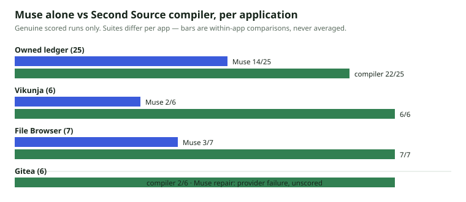

# Claude Across Applications — Cross-App Report

**Packet:** `muse-cross-app-20261104` · Meta Muse Spark 1.3 (`REAL_MODEL`)
**Cap:** 4 calls / $0.50 hard · **Spent:** 4 booked attempts, ≈ **$0.032** total
**Receipts:** durable fsync ledger (`.runs/muse-cross-app-20261104/receipts.jsonl`)
**Date:** 4 November 2026

Until now, genuine Muse evidence existed only for the ledger (14/25) and
Vikunja (2/6, 1/6, gated hybrid). This packet runs Muse on the other
applications, with the same discipline: public evidence only, independent
scoring, provider failures unscored.

## Results

| Application | Suite | Muse alone | Muse + Second Source | Compiler alone (NON_AI) |
|---|---|---|---|---|
| Owned ledger | sealed 25-case | **14/25** (recorded) | — | 22/25 |
| Vikunja v2.4.0 | frozen held-out 6 | **2/6** grounded · **1/6** active (recorded) | raw 6/6 + 6/6 once; gated = compiler (tie) | **6/6** (+6/6 extended) |
| File Browser v2.63.23 | differential 7 (new) | **3/7** | not run (compiler at ceiling) | **7/7** |
| Gitea 1.22.6 | public 6 + frozen held-out 4 (new) | repair: **provider failure — unscored** | — | 2/6 |

## File Browser — Muse alone (grounded), new result: 3/7

Method mirrors the Vikunja grounded arm: Muse received only public probe
observations (no compiled spec, no held-out data) and authored a candidate
spec in one response.

| Case | Muse alone | Compiler |
|---|---|---|
| FB-STATE-1 login/token lifecycle | ✗ | ✓ |
| FB-ERROR-1 wrong password → 401 | ✓ | ✓ |
| FB-ERROR-2 non-admin create → 403 | ✓ | ✓ |
| FB-REL-1 user create/read | ✗ | ✓ |
| FB-MULTI-1 second-user isolation | ✗ | ✓ |
| FB-NEG-1 duplicate-user contract | ✗ | ✓ |
| FB-CONTROL mutated-spec control | ✓ (differs as required) | ✓ |
| **Total** | **3/7** | **7/7** |

Reading: Muse reproduced the visible error contracts (401, 403) but missed
stateful lifecycle, cross-user relationships, and the duplicate contract —
the same failure family as Vikunja (2/6): observed constants and state
rules are exactly what unaided synthesis guesses wrong. First attempt also
failed at the provider (empty truncated response) and was retried within
the packet cap; both attempts are in the receipts.

## Gitea — Muse repair attempt: provider failure, unscored

The task was the cleanest possible improvement test: the NON_AI baseline is
2/6 with a diagnosed cause (literal route templates). Muse was asked for
minimal path-generalization rules, to be gated on the 6 public cases and
then scored once on 4 held-out cases frozen (SHA-256
`492ffa05…cfd2`) before the prompt was built. **Both repair calls failed
at the provider** (`RemoteDisconnected`), and the packet's 4-call cap was
reached. Result: **no Muse score for Gitea** — the 2/6 compiler baseline
stands, and the repair experiment remains open for a future packet. The
held-out set stays sealed and unused.

## Cost & reliability (this packet)

| Attempt | Outcome | Booked |
|---|---|---|
| FB alone #1 | provider: empty truncated response | yes |
| Gitea repair #1 | provider: connection closed | yes |
| FB alone #2 | **scored 3/7** | yes |
| Gitea repair #2 | provider: connection closed | yes |
| **Total** | 1 of 2 experiments scored | **≈ $0.032 / $0.50 cap** |

Provider reliability, not budget, is currently the binding constraint on
more Muse evidence: 3 of 4 attempts in this packet failed at the gateway.

## Conclusions

1. The pattern is now consistent across **three** applications (ledger,
   Vikunja, File Browser): Muse alone lands between 2/6 and 14/25 —
   it reproduces visible contracts and misses hidden state rules.
2. The compiler's advantage is transcription fidelity, not intelligence;
   the honest product claim stays: evidence first, model for unknowns,
   gates before acceptance.
3. Next packet (owner-approved): retry the Gitea repair when the provider
   is stable — the experiment is designed, frozen, and costed (≈ $0.02).
